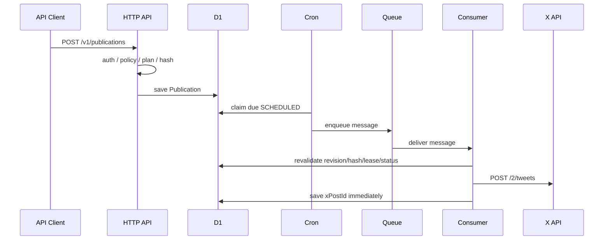

# 状態と安全ルール

このシステムは、投稿依頼を状態遷移で管理します。重要なのは、Xへ送信できるのはQueue Consumerだけで、Consumerも投稿直前に安全条件を再確認することです。

## Publication Status

主な状態は次のとおりです。

| Status | 意味 |
|---|---|
| `DRAFT` | 下書き。予約・投稿されない |
| `PENDING_APPROVAL` | 人間承認待ち |
| `SCHEDULED` | 予約済み。Cronの対象 |
| `QUEUED` | Queueへ投入済み。lease中 |
| `PUBLISHING` | ConsumerがXへ送信中 |
| `AWAITING_FOLLOW_UP` | ルート投稿は成功し、将来のfollow-up待ち |
| `PUBLISHED` | 予定されたStepがすべて成功 |
| `FAILED` | 投稿未作成と判断できる明示的失敗 |
| `DELIVERY_UNKNOWN` | 投稿された可能性があり、自動再送禁止 |
| `RETRY_SCHEDULED` | 明示的失敗またはrate limit後の再実行待ち |
| `BLOCKED_POLICY` | 実行直前の再検証で停止 |
| `REJECTED` | 人間が却下 |
| `CANCELLED` | 取消済み |

## Step Status

StepはXへ送る1回分の投稿です。

| Status | 意味 |
|---|---|
| `PENDING` | 未実行 |
| `PUBLISHING` | 送信中 |
| `PUBLISHED` | X Post ID保存済み |
| `RETRY_SCHEDULED` | 再実行待ち |
| `FAILED` | 明示的失敗 |
| `DELIVERY_UNKNOWN` | 結果不明 |

`PUBLISHED` のStepは再送しません。これがQueue重複配信時の重複投稿防止になります。

## 作成から投稿まで

## 投稿直前の再確認

ConsumerはX APIを呼ぶ前に、少なくとも次を確認します。

- Queue Messageのversion
- Publicationの存在
- revision一致
- contentHash一致
- leaseToken一致
- 状態が `QUEUED`
- 作成元API Clientが有効
- X Accountが有効
- ClientとAccountの権限が現在も有効
- ポリシーが `DENY` ではない
- 承認が必要な場合、有効な承認がある
- 対象Stepが未投稿

古いQueue messageや、既に状態が変わったmessageはno-opで終了します。

## Delivery Unknown

次のような場合は、Xに投稿された可能性を否定できません。

- timeout
- connection reset
- 5xx
- response解析不能
- post IDがない成功風response

この場合は `DELIVERY_UNKNOWN` にして停止します。自動retryはしません。人間がX上で投稿有無を確認し、`reconcile` で確定します。

## 安全ルール

- 認証されていないrequestからXへ投稿しない
- AI Actorに承認・却下・reconcileを許可しない
- 承認後に内容が変わったら承認を無効化する
- 同じHTTP request再送でPublicationを重複作成しない
- Queue重複配信で同じX投稿を重複作成しない
- Xへの送信結果が不明な場合は自動再送しない
- 投稿直前にも権限、承認、revision、contentHash、policyを再確認する
- 重要操作はaudit logへ残す
