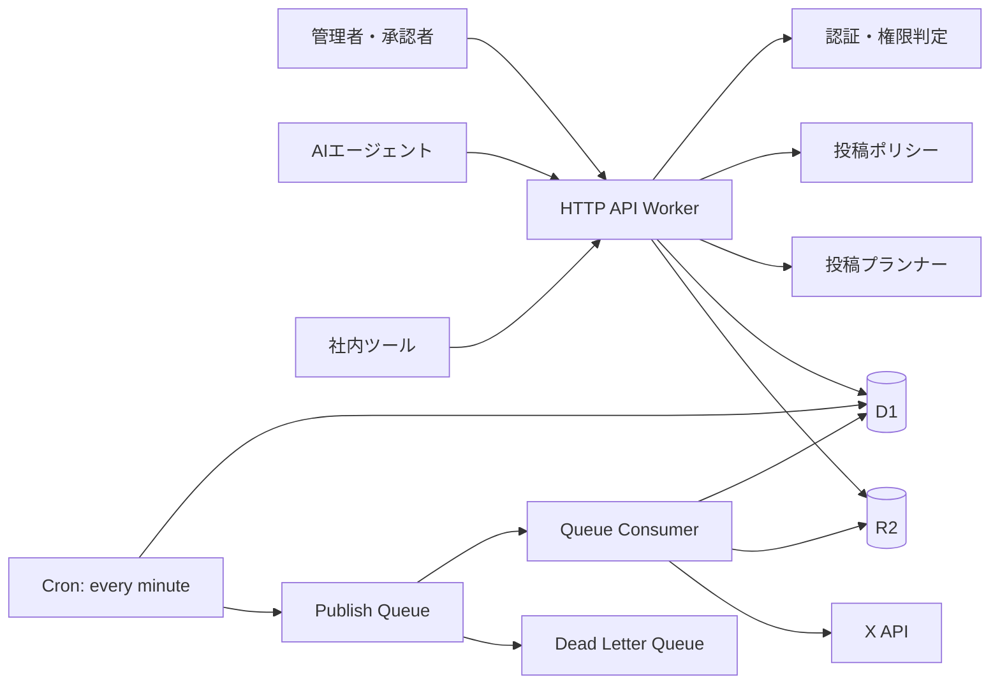
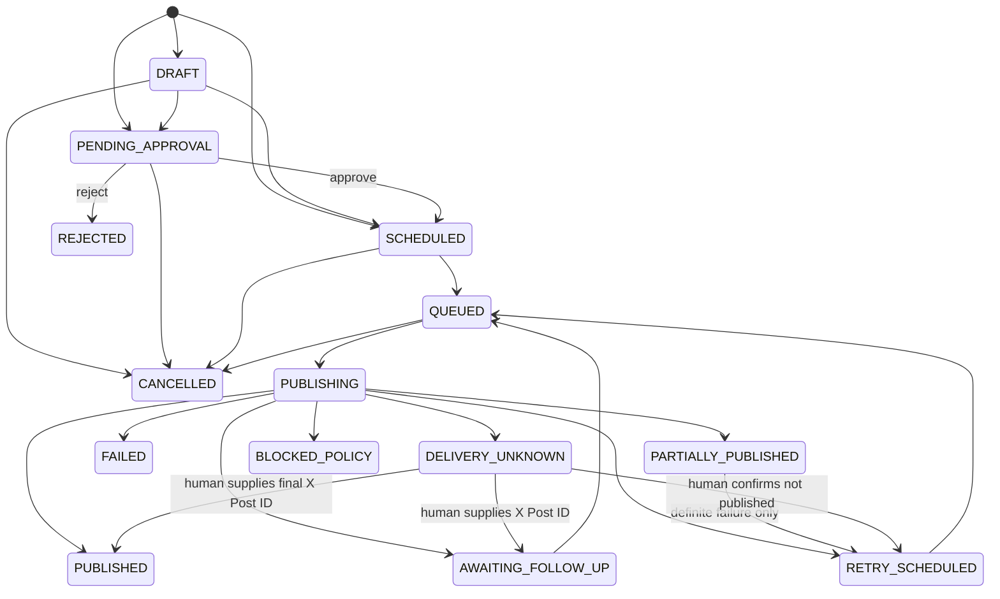

# X投稿オーケストレーター 実装仕様書（Codex向け）

- 文書バージョン: 0.1.0
- 外部仕様確認日: 2026-06-21
- 対象: 新規バックエンド実装
- 実装方針: Cloudflare上のモジュラーモノリス

---

## 0. Codexへの実行指示

この文書を実装上のSource of Truthとして扱うこと。

1. まずリポジトリを確認し、実装計画を短く提示する。
2. 既存コードがなければ、本書の構成で新規プロジェクトを作成する。
3. 要件を黙って変更しない。外部APIの都合で変更が必要な場合は、保守的な代替案を採用し、READMEに理由を残す。
4. 実装は「18. 実装順序」に従う。
5. Xへの実投稿は自動テストやCIから行わない。明示的な環境変数がある場合だけ動く手動スモークテストとして実装する。
6. シークレット、アクセストークン、Refresh Token、APIキーをコード・ログ・テストデータへ記録しない。
7. 最後に以下を実行し、すべて成功させる。

```bash
pnpm lint
pnpm typecheck
pnpm test
pnpm build
```

8. 完了報告には、実装内容、テスト結果、外部環境でのみ確認可能な項目を分けて記載する。

### 絶対に守る安全条件

- 認証・権限確認を通過していない要求からXへ投稿しない。
- AIクライアントに承認権限を与えない。
- 人間承認後に本文、画像、投稿先、日時、投稿計画のいずれかが変わった場合、承認を無効化する。
- 同一のAPI要求やQueueメッセージが再送されても、同じX投稿を重複作成しない。
- Xへの送信結果が不明な場合は、自動再送しない。
- 投稿直前にも権限、承認、リビジョン、内容ハッシュ、ポリシーを再確認する。
- すべての重要操作を監査ログへ残す。

---

## 1. 目的

管理画面、人間向けツール、AIエージェントから安全に呼び出せる、X投稿専用バックエンドを構築する。

利用者は投稿内容と日時を指定するだけで、権限・ポリシー・必要な人間承認を経て、予約時刻にXへ投稿できること。

### 対応する投稿

1. 通常のテキスト投稿
2. 投票投稿
3. 投票投稿への予約リプライ
4. 画像付き投稿
5. 長文投稿
6. 長文投稿が利用できない場合のスレッド投稿へのフォールバック

### 対応する呼び出し元

- 管理画面
- 社内ツール
- AIエージェント
- バッチ処理

---

## 2. スコープ

### MVPに含める

- X OAuth 2.0 Authorization Code Flow with PKCE
- 複数Xアカウントの接続
- 内部APIキー認証
- 呼び出し元ごとのXアカウント許可
- 権限レベル0〜3
- 人間による承認・却下
- 予約投稿
- 通常投稿
- 静止画像付き投稿
- 投票投稿
- 投票への静的な予約リプライ
- 長文投稿とスレッドフォールバック
- 投稿プレビュー
- 冪等性
- 再試行制御
- 監査ログ
- 構造化ログ
- ローカルテスト用Fake X Adapter
- 手動スモークテスト

### MVPに含めない

- 投稿内容を生成するAIそのもの
- 投票結果をAIが分析して文章を自動生成する処理
- 動画投稿
- 音声投稿
- Spaceの操作
- DM送信
- X上の投稿一覧を完全同期する機能
- 投稿済みコンテンツの自動削除・ロールバック
- 管理画面UI
- 高度なマルウェアスキャン
- Enterprise専用機能

---

## 3. 外部仕様の前提

実装時には最新のX公式ドキュメントとCloudflare公式ドキュメントを再確認すること。本書で固定するのはドメイン要件であり、外部APIの価格・レート上限・エラー詳細をハードコードしない。

### X API

- 投稿作成は `POST /2/tweets` を使用する。
- 投稿にはユーザーコンテキストの認証が必要。
- 返信は `reply.in_reply_to_tweet_id` を使用する。
- 投票と画像は同一投稿に同時添付できない。
- 通常投稿は重み付き280文字を基準とする。
- 日本語、中国語、韓国語、絵文字などは重み2として扱われるため、JavaScriptの `string.length` だけで判定しない。
- 文字数判定には `twitter-text` 相当の公式ルールを用いる。
- 画像はXへ投稿する直前にアップロードし、得られた `media_id` を投稿へ付ける。
- OAuth 2.0では、予約投稿に必要なRefresh Tokenを得るため `offline.access` を要求する。
- 必要スコープは原則として以下とする。

```text
tweet.read
tweet.write
users.read
offline.access
media.write
```

- AI生成メディアを添付する場合のみ、X APIの対応項目へ `made_with_ai` を設定する。AIが本文を生成したという理由だけで、この項目を自動設定しない。
- 2026年2月以降、セルフサービスAPIにはプログラムによる返信制限がある。自己スレッドと自分の投票への返信が対象アカウントで利用できるか、実アカウントの手動スモークテストを必須とする。

### Cloudflare

- Cron TriggerはUTCで動作する。
- 1分間隔のCronで期限到来投稿を検出する。
- Queueは少なくとも1回配信される前提で、Consumerを冪等にする。
- Dead Letter Queueを設定する。
- D1のロックに `SELECT FOR UPDATE` を期待せず、条件付きUPDATEによるCompare-And-Setを使う。

---

## 4. 採用技術

| 項目 | 採用技術 |
|---|---|
| 言語 | TypeScript、strict mode |
| Runtime | Cloudflare Workers |
| HTTP | Hono |
| Validation | Zod |
| Database | Cloudflare D1 / SQLite |
| ORM | Drizzle ORM |
| Object Storage | Cloudflare R2 |
| Async | Cloudflare Queues + DLQ |
| Scheduler | Cloudflare Cron Triggers |
| Test | Vitest |
| Character count | twitter-text |
| Package manager | pnpm |
| Encryption | Web Crypto API / AES-256-GCM |
| X連携 | `XClient` Interface越しのREST Adapter |

X公式SDKへ将来切り替えられるよう、X API呼び出しは必ずPort/Adapterで分離する。MVPはCloudflare Workersとの互換性を優先し、標準 `fetch` によるREST Adapterでよい。

---

## 5. 全体構成



### MVPのデプロイ単位

最初から複数マイクロサービスへ分割しない。1つのWorkerで以下を実装する。

- `fetch()` : HTTP API
- `scheduled()` : 期限到来投稿の検出
- `queue()` : Xへの投稿処理

内部モジュールは分離するが、デプロイは単一とする。

---

## 6. ドメインモデル

### Publication

利用者が作成する「投稿依頼」の単位。

- 投稿先Xアカウント
- 本文
- 画像または投票
- 投稿日時
- 長文時の扱い
- 投票後のリプライ
- 投稿プラン
- ポリシー判定
- 承認状態
- 実行状態

### Publication Plan

PublicationをXへどのように投稿するかを表す。

- `PRIMARY`: 第一候補
- `FALLBACK`: 第一候補が明示的に利用不能な場合の代替

例:

```text
PRIMARY  = LONGFORM_SINGLE
FALLBACK = THREAD
```

承認時にはPRIMARYとFALLBACKの両方を提示し、両方を内容ハッシュへ含める。承認後に新しい文章分割を作り直してはならない。

### Publication Step

Xへ送る1回分の投稿。

- ルート投稿
- スレッド内の返信
- 投票終了後の返信

投稿成功直後にXのPost IDを保存する。

### Media Asset

R2へ保存した投稿前画像。

- ファイルハッシュ
- MIME type
- サイズ
- 代替テキスト
- AI生成画像かどうか

---

## 7. 投稿種別と制約

| 種別 | 本文 | 画像 | 投票 | 長文 | スレッド | 後続リプライ |
|---|---:|---:|---:|---:|---:|---:|
| TEXT | 必須 | 不可 | 不可 | 可 | 可 | MVP外 |
| IMAGE | 必須 | 1〜4枚 | 不可 | MVPでは不可 | 可 | MVP外 |
| POLL | 必須 | 不可 | 必須 | 不可 | 不可 | 可 |

### TEXT

- 標準文字数内なら通常投稿。
- 超過時は `overflowPolicy` に従う。

### IMAGE

- 静止画像のみ。
- MIME typeは `image/jpeg`、`image/png`、`image/webp`。
- 1ファイル5MB以下。
- 最大4枚。
- 長文の場合、画像はスレッドの1件目だけに付ける。
- GIF、動画はMVP外。

### POLL

- 画像との併用不可。
- 本文は通常投稿の重み付き文字数内であること。
- 選択肢数、選択肢文字数、期間はX APIへ送る前に検証するが、外部制約値は設定またはAdapter側へ閉じ込める。
- X API側の現行制約と一致しない場合は、422で返す。

### 投票へのリプライ

MVPでは静的なテキストだけを扱う。

トリガー:

- `AFTER_PARENT_PUBLISHED`: 投票投稿成功から指定分後
- `AFTER_POLL_CLOSE`: 投票終了から指定分後

制約:

- 最大3件。
- 各リプライは通常投稿の文字数内。
- 自己返信機能が未検証または無効のアカウントでは作成を拒否する。

---

## 8. 長文・スレッド変換

### overflowPolicy

```text
REJECT
THREAD
LONGFORM_THEN_THREAD
```

- `REJECT`: 標準文字数超過時に422。
- `THREAD`: 最初からスレッド化。
- `LONGFORM_THEN_THREAD`: 長文投稿を第一候補とし、利用不能が明示された場合だけ承認済みスレッドへ切り替える。

`TRUNCATE` は文章欠落の危険があるため実装しない。

### アカウント能力

`x_accounts` に以下を保持する。

```text
longform_capability: UNKNOWN | ENABLED | DISABLED
self_reply_capability: UNVERIFIED | ENABLED | DISABLED
```

- `UNKNOWN` / `UNVERIFIED` は自動的に有効扱いしない。
- 能力は手動スモークテスト後に管理者が更新する。

### 分割アルゴリズム

1. `twitter-text` で重み付き文字数を計算する。
2. URLを途中で分割しない。
3. Unicode grapheme clusterを途中で分割しない。
4. 次の優先順で自然な境界を探す。
   1. 空行・段落
   2. 改行
   3. `。！？!?` などの文末
   4. 句読点
   5. 空白
   6. grapheme cluster
5. 番号を付ける場合は末尾に `\n\n(1/4)` 形式で付ける。
6. 番号分を含めて各パートの文字数を再計算する。
7. 総パート数の桁が変わる可能性があるため、結果が安定するまで再計算する。
8. `maxParts` を超える場合は422。

デフォルト:

```text
numbering = true
maxParts = 10
mediaPlacement = FIRST
```

### フォールバック条件

長文からスレッドへ切り替えてよいのは、X APIから「長文利用権限なし」「文字数超過」等の明示的かつ投稿未作成と判断できるエラーを受けた場合だけ。

以下ではフォールバックしない。

- 通信タイムアウト
- 接続切断
- 5xx
- 応答本文を解釈できない場合
- 投稿が作成された可能性を排除できない場合

これらは `DELIVERY_UNKNOWN` とする。

---

## 9. 認証・権限・承認

### 内部APIキー

形式例:

```text
xps_<key-prefix>.<32-byte-random-secret>
```

保存方法:

- DBには平文を保存しない。
- `key_prefix` を検索用に保存する。
- secretは `HMAC-SHA-256(API_KEY_PEPPER, full_api_key)` として保存する。
- 比較は定時間比較を使う。
- APIキーは有効期限、無効化状態、最終利用日時を持つ。

HTTP:

```http
Authorization: Bearer xps_xxxxx.yyyyy
```

### Actor Type

```text
AI
HUMAN
SERVICE
```

AI Actorへ `publication:approve`、`publication:reject`、`publication:reconcile` を付与してはならない。DB投入時とアプリケーション実行時の両方で拒否する。

### Scope

```text
publication:preview
publication:create
publication:submit
publication:read
publication:update
publication:cancel
publication:approve
publication:reject
publication:retry
publication:reconcile
media:create
account:read
account:manage
```

### 権限レベル

権限はAPI ClientとX Accountの組み合わせごとに設定する。

| レベル | 名称 | 動作 |
|---:|---|---|
| 0 | DENY | 閲覧を含め、許可されたScope以外は利用不可。投稿作成は常に拒否 |
| 1 | DRAFT_ONLY | 下書き作成のみ。予約・投稿不可 |
| 2 | HUMAN_APPROVAL_REQUIRED | 人間承認後にのみ予約 |
| 3 | POLICY_BASED_AUTO | ポリシー内だけ自動予約。範囲外は人間承認 |

### ポリシー判定結果

```text
DENY
REQUIRE_APPROVAL
ALLOW
```

呼び出し元の指定は判定を緩くできない。

```text
最終判定 = max(権限レベルの要求, サーバーポリシー, 呼び出し元の安全側指定)
```

### デフォルトポリシー

レベル3でも以下をすべて満たす場合だけ自動投稿を許可する。

- TEXT投稿
- 1投稿だけ
- 標準文字数内
- URLなし
- `@mention` なし
- 画像なし
- 投票なし
- 後続リプライなし
- 禁止語・禁止パターンなし
- 許可された時間帯
- 日次投稿上限内
- 重複投稿検知に該当しない
- Xアカウント能力が有効

以下は原則として人間承認を要求する。

- URL付き投稿
- 画像
- 投票
- スレッド
- 長文
- 返信
- 明示的なアカウントメンション
- 深夜帯
- 通常より多い投稿頻度

以下は拒否する。

- 禁止語・禁止正規表現への一致
- 許可されていないXアカウント
- 最大スレッド数超過
- 不正な画像
- 投票と画像の同時指定
- 過去の日時
- 投稿上限超過
- 外部の任意Post IDへの返信
- 自己返信能力未検証時のスレッド・投票リプライ

### 承認の拘束対象

承認は次の全項目に対して行う。

- XアカウントID
- 投稿日時
- 正規化済み本文
- 添付画像のSHA-256
- 投票内容
- 後続リプライ
- PRIMARY Plan
- FALLBACK Plan
- overflowPolicy
- 現在のrevision

上記を正規化したCanonical JSONのSHA-256を `content_hash` とする。

### 承認無効化

以下の操作でrevisionを増加し、既存承認を無効化する。

- 本文変更
- 画像変更
- 代替テキスト変更
- 投稿先変更
- 投稿日時変更
- 投票変更
- 後続リプライ変更
- スレッド分割設定変更
- overflowPolicy変更

投稿直前に有効な承認が見つからない場合は投稿せず、`PENDING_APPROVAL` へ戻す。

---

## 10. API仕様

Base path:

```text
/v1
```

すべてJSON。画像アップロードのみ `multipart/form-data`。

書き込みAPIでは、特記しない限り以下を必須とする。

```http
Authorization: Bearer <api-key>
Idempotency-Key: <client-generated-key>
Content-Type: application/json
```

### エンドポイント一覧

| Method | Path | 用途 |
|---|---|---|
| GET | `/healthz` | ヘルスチェック |
| POST | `/v1/publications/preview` | 保存せず検証・分割・ポリシー判定 |
| POST | `/v1/publications` | 投稿依頼作成 |
| POST | `/v1/publications/:id/submit` | 下書きを提出し、再判定 |
| GET | `/v1/publications` | 一覧取得 |
| GET | `/v1/publications/:id` | 詳細取得 |
| PATCH | `/v1/publications/:id` | 編集・再判定 |
| POST | `/v1/publications/:id/approve` | 人間承認 |
| POST | `/v1/publications/:id/reject` | 人間却下 |
| POST | `/v1/publications/:id/cancel` | 取消 |
| POST | `/v1/publications/:id/retry` | 明示的失敗の再実行 |
| POST | `/v1/publications/:id/reconcile` | 不明結果の人間による確定 |
| POST | `/v1/media` | 画像アップロード |
| GET | `/v1/media/:id` | 画像メタデータ取得 |
| POST | `/v1/x/accounts` | Xアカウント接続用レコード作成 |
| GET | `/v1/x/accounts` | 接続アカウント一覧 |
| GET | `/v1/x/oauth/authorize` | OAuth開始 |
| GET | `/v1/x/oauth/callback` | OAuth callback |
| POST | `/v1/x/accounts/:id/disable` | 投稿停止 |
| PATCH | `/v1/x/accounts/:id/capabilities` | 手動検証済み能力更新 |

Xへ直接投稿する公開 `publish` APIは作らない。すべてPublicationとして保存し、Queue ConsumerだけがX APIを呼び出す。

### 10.1 投稿プレビュー

```http
POST /v1/publications/preview
```

#### Request

```json
{
  "xAccountId": "acc_123",
  "scheduledAt": "2026-06-22T12:00:00+09:00",
  "kind": "POLL",
  "content": {
    "text": "登録販売者試験で苦手な分野は？",
    "poll": {
      "options": ["医薬品", "人体", "法規", "安全対策"],
      "durationMinutes": 1440
    }
  },
  "overflowPolicy": "REJECT",
  "threadOptions": {
    "numbering": true,
    "maxParts": 10,
    "mediaPlacement": "FIRST"
  },
  "followUps": [
    {
      "trigger": {
        "type": "AFTER_POLL_CLOSE",
        "offsetMinutes": 5
      },
      "content": {
        "text": "回答ありがとうございました！"
      }
    }
  ],
  "approvalPreference": "POLICY"
}
```

#### Response

```json
{
  "normalized": {
    "scheduledAtUtc": "2026-06-22T03:00:00.000Z",
    "kind": "POLL"
  },
  "plans": [
    {
      "kind": "PRIMARY",
      "strategy": "STANDARD_SINGLE",
      "steps": [
        {
          "sequence": 1,
          "relation": "ROOT",
          "weightedLength": 36,
          "text": "登録販売者試験で苦手な分野は？"
        }
      ]
    }
  ],
  "policy": {
    "decision": "REQUIRE_APPROVAL",
    "reasons": ["POLL_REQUIRES_HUMAN_APPROVAL"]
  },
  "capabilities": {
    "longform": "DISABLED",
    "selfReply": "ENABLED"
  },
  "estimate": {
    "postCreateRequests": 2,
    "mediaUploads": 0,
    "threadParts": 1
  },
  "warnings": [],
  "contentHash": "sha256-hex"
}
```

`preview` は保存せず、X APIも呼び出さない。

### 10.2 投稿依頼作成

```http
POST /v1/publications
```

Requestはpreviewと同一。

状態決定:

```text
Level 0                    -> 403
Level 1                    -> DRAFT
Level 2                    -> PENDING_APPROVAL
Level 3 + policy ALLOW     -> SCHEDULED
Level 3 + REQUIRE_APPROVAL -> PENDING_APPROVAL
policy DENY                -> 422
```

#### Response

```json
{
  "publication": {
    "id": "pub_123",
    "revision": 1,
    "status": "PENDING_APPROVAL",
    "xAccountId": "acc_123",
    "scheduledAtUtc": "2026-06-22T03:00:00.000Z",
    "contentHash": "sha256-hex"
  },
  "policy": {
    "decision": "REQUIRE_APPROVAL",
    "reasons": ["POLL_REQUIRES_HUMAN_APPROVAL"]
  },
  "approval": {
    "required": true,
    "activeApprovalId": null
  }
}
```

### 10.3 編集

```http
PATCH /v1/publications/:id
```

許可状態:

```text
DRAFT
PENDING_APPROVAL
SCHEDULED
```

禁止状態:

```text
QUEUED
PUBLISHING
AWAITING_FOLLOW_UP
PUBLISHED
PARTIALLY_PUBLISHED
FAILED
DELIVERY_UNKNOWN
CANCELLED
REJECTED
```

編集時は全文置換ではなくてもよいが、サーバー内では最終Requestを再構築し、全検証・再プラン・再ポリシー判定を行う。

- revisionを1増やす。
- content_hashを再計算する。
- 既存承認を無効化する。
- 状態を再決定する。

### 10.4 下書きの提出

```http
POST /v1/publications/:id/submit
```

- `DRAFT` のみ許可する。
- `publication:submit` Scopeを要求する。
- 呼び出し元は対象X Accountに対して権限レベル2以上を持つ `HUMAN` または運用 `SERVICE` とする。
- 現在のRequestを再検証し、投稿Plan、contentHash、ポリシーを再計算する。
- ポリシーが `DENY` の場合は422。
- 人間承認が必要なら `PENDING_APPROVAL`、不要なら `SCHEDULED` へ遷移する。
- 提出操作そのものを承認として扱わない。承認が必要な場合は別途approve APIを呼ぶ。

### 10.5 承認

```http
POST /v1/publications/:id/approve
```

```json
{
  "revision": 1,
  "contentHash": "sha256-hex",
  "comment": "内容確認済み"
}
```

- `HUMAN` Actorかつ `publication:approve` 必須。
- Requestのrevision/hashが現在値と一致しない場合は409。
- `PENDING_APPROVAL` 以外は409。
- 成功後は `SCHEDULED`。
- 投稿日時を過ぎている場合は、設定されたgrace period内だけ即時Queue対象にする。超過時は422とし、日時変更を求める。

### 10.6 却下

```http
POST /v1/publications/:id/reject
```

```json
{
  "revision": 1,
  "contentHash": "sha256-hex",
  "reason": "表現を修正してください"
}
```

- HUMANのみ。
- 状態を `REJECTED` にする。
- 編集して再提出する場合はPATCHでrevisionを増やし、再判定する。

### 10.7 取消

```http
POST /v1/publications/:id/cancel
```

- `DRAFT`、`PENDING_APPROVAL`、`SCHEDULED`、`QUEUED` で許可。
- `QUEUED` の場合、Consumerが状態確認してNo-opにする。
- すでにXへ1件でも投稿済みの場合は自動削除せず409。

### 10.8 Retry

```http
POST /v1/publications/:id/retry
```

- `FAILED` かつ失敗が明示的に「投稿未作成」と判断できる場合のみ。
- `DELIVERY_UNKNOWN` では禁止。
- HUMANまたは明示的な運用SERVICEのみ。

### 10.9 Reconcile

```http
POST /v1/publications/:id/reconcile
```

#### 投稿済みとして確定

```json
{
  "stepId": "step_123",
  "outcome": "PUBLISHED",
  "xPostId": "1234567890",
  "comment": "X上で投稿を確認"
}
```

#### 未投稿として確定

```json
{
  "stepId": "step_123",
  "outcome": "NOT_PUBLISHED",
  "comment": "X上と投稿履歴を確認"
}
```

- HUMANかつ `publication:reconcile` 必須。
- `DELIVERY_UNKNOWN` のみ。
- `NOT_PUBLISHED` 確定後にのみRetry可能。

### 10.10 画像アップロード

```http
POST /v1/media
Content-Type: multipart/form-data
```

Fields:

```text
xAccountId: string
file: binary
altText: string, optional, max 1000
aiGenerated: boolean, default false
```

検証:

- 拡張子ではなくMagic Bytesを確認する。
- 許可MIME typeを確認する。
- 5MB以下。
- SHA-256を計算する。
- 同一クライアント・同一ファイルの短時間重複は同じAssetを返してよい。

Response:

```json
{
  "media": {
    "id": "media_123",
    "mimeType": "image/png",
    "sizeBytes": 1048576,
    "sha256": "...",
    "altText": "学習するくまのイラスト",
    "aiGenerated": false,
    "status": "READY"
  }
}
```

### 10.11 エラー形式

```json
{
  "error": {
    "code": "APPROVAL_REQUIRED",
    "message": "Human approval is required.",
    "details": {
      "reasons": ["POLL_REQUIRES_HUMAN_APPROVAL"]
    }
  },
  "requestId": "req_123"
}
```

HTTP status:

| Status | 用途 |
|---:|---|
| 400 | JSON形式・必須値不正 |
| 401 | 未認証 |
| 403 | Scope・Account・権限不足 |
| 404 | 対象なし、または閲覧権限なし |
| 409 | 状態競合、revision不一致、冪等キー競合 |
| 422 | ドメイン検証・ポリシー違反 |
| 429 | 内部APIのレート制限 |
| 500 | 内部エラー |
| 502 | X APIの明示的な外部障害 |

---

## 11. 状態遷移

### Publication Status

```text
DRAFT
PENDING_APPROVAL
SCHEDULED
QUEUED
PUBLISHING
AWAITING_FOLLOW_UP
PUBLISHED
PARTIALLY_PUBLISHED
RETRY_SCHEDULED
FAILED
DELIVERY_UNKNOWN
BLOCKED_POLICY
REJECTED
CANCELLED
```



### Step Status

```text
PENDING
READY
UPLOADING_MEDIA
PUBLISHING
PUBLISHED
RETRY_SCHEDULED
FAILED
DELIVERY_UNKNOWN
SKIPPED
```

### 定義

- `PUBLISHED`: 予定されたすべてのStepが成功。
- `AWAITING_FOLLOW_UP`: ルートまたはスレッドは成功し、将来時刻の投票リプライが残る。
- `PARTIALLY_PUBLISHED`: スレッドの一部は投稿済みだが、後続Stepが明示的に失敗。
- `DELIVERY_UNKNOWN`: Xに作成された可能性があり、自動再送できない。

---

## 12. スケジューラー・Queue・冪等性

### 時刻

- APIはタイムゾーンOffset付きISO 8601を要求する。
- `2026-06-22T12:00:00+09:00` は許可。
- `2026-06-22T12:00:00` は拒否。
- DBにはUTCのUnix epoch millisecondsを保存する。
- CronはUTCで実行する。

### Publicationの次回実行時刻

`publications.next_action_at_ms` を持たせる。

- 初回: `scheduled_at_ms`
- Rate Limit後: `retry_at_ms`
- 投票投稿後: 実際の `published_at + poll_duration + offset`
- 完了後: `NULL`

### Cron処理

毎分実行する。

1. 以下を満たすPublication候補を取得する。
   - 状態が `SCHEDULED`、`AWAITING_FOLLOW_UP`、`RETRY_SCHEDULED`
   - `next_action_at_ms <= now`
   - leaseがない、または期限切れ
2. Publicationごとにランダムな `lease_token` を生成する。
3. 条件付きUPDATEでclaimする。
4. 更新件数が1の場合だけQueueへ送る。
5. Queue Message送信後に監査ログを残す。

条件付きUPDATE例:

```sql
UPDATE publications
SET status = 'QUEUED',
    lease_token = ?,
    lease_until_ms = ?,
    updated_at_ms = ?
WHERE id = ?
  AND revision = ?
  AND content_hash = ?
  AND status IN ('SCHEDULED', 'AWAITING_FOLLOW_UP', 'RETRY_SCHEDULED')
  AND next_action_at_ms <= ?
  AND (lease_until_ms IS NULL OR lease_until_ms < ?);
```

### Queue Message

```json
{
  "version": 1,
  "publicationId": "pub_123",
  "revision": 1,
  "contentHash": "sha256-hex",
  "leaseToken": "random-token",
  "reason": "SCHEDULED",
  "enqueuedAtMs": 1782097200000
}
```

### Consumerの再検証

X APIを呼び出す前に必ず以下を確認する。

- Queue Message schema
- Publication存在
- revision一致
- contentHash一致
- leaseToken一致
- 状態が `QUEUED`
- API Clientが現在も有効
- ClientとAccountの権限が現在も有効
- X AccountがACTIVE
- ポリシー再評価がDENYでない
- 必要な承認が現在も有効
- キャンセルされていない
- 対象Stepが未投稿

一致しない古いメッセージはackして終了する。

### 冪等キー

- 書き込み要求には `Idempotency-Key` を要求する。
- 一意範囲は `(api_client_id, idempotency_key)`。
- Request bodyをCanonical JSON化し、request hashを保存する。
- 同じキー・同じhashなら、最初のResponseを返す。
- 同じキー・異なるhashなら409。
- `IN_PROGRESS` が長時間残った場合に復旧できるよう期限を持つ。

### X APIに対する冪等性

X APIにサービス側Idempotency-Keyがあるとは仮定しない。

- 各Stepの送信前に状態を `PUBLISHING` として記録。
- 成功Responseを得たら、次のStepへ進む前にX Post IDを保存。
- Queue重複配信時は、X Post IDがあるStepを再送しない。
- 通信結果が不明なら `DELIVERY_UNKNOWN` として停止。

---

## 13. X投稿処理

### 基本フロー

```text
1. Publicationと有効Planを読み込む
2. 実行対象Stepを決定する
3. Tokenの有効期限を確認する
4. 必要ならRefresh Tokenで更新する
5. R2画像をXへアップロードする
6. 代替テキスト等のメタデータを設定する
7. POST /2/tweets を実行する
8. X Post IDを直ちに保存する
9. 後続Stepのreply先へX Post IDを設定する
10. 次のStepまたは待機状態へ進める
```

### Thread

- 1件目はROOT。
- 2件目以降は直前の成功したPost IDへ返信する。
- Step 3で失敗した場合、再実行時にStep 1と2を再投稿しない。
- 自動削除によるロールバックは行わない。

### Poll Follow-up

- 投票投稿の成功時刻を基準にする。
- `AFTER_PARENT_PUBLISHED`: `published_at + offset`
- `AFTER_POLL_CLOSE`: `published_at + duration_minutes + offset`
- 計算後、Follow-up Stepの `resolved_due_at_ms` とPublicationの `next_action_at_ms` を保存する。
- 状態を `AWAITING_FOLLOW_UP` にしてleaseを解放する。

### Token Refresh

- Access TokenとRefresh Tokenを暗号化してD1へ保存する。
- 有効期限より安全マージン分早く更新する。
- Refresh Tokenがローテーションされた場合は、新しいTokenを原子的に保存する。
- Refresh失敗時はAccountを `AUTH_ERROR` にし、投稿しない。

### Rate Limit

- 429の場合、レスポンスヘッダーのReset時刻を優先する。
- jitterを加え、`RETRY_SCHEDULED` と `next_action_at_ms` を設定する。
- Queue Message自体はackし、Cronから再投入する。
- 無限再試行をしない。最大試行回数を設定可能にする。

### エラー分類

| 状況 | 分類 | 自動再試行 |
|---|---|---|
| 2xx + Post ID | SUCCESS | 不要 |
| 400/401/403/404/422 | DEFINITE_FAILURE | 原則しない |
| 429 | RATE_LIMITED | Reset後に可 |
| 明示的な長文非対応エラー | FALLBACK_ELIGIBLE | 承認済みFallbackのみ可 |
| 5xx | DELIVERY_UNKNOWN | しない |
| fetch timeout / connection reset | DELIVERY_UNKNOWN | しない |
| Response解析不能 | DELIVERY_UNKNOWN | しない |

5xxやネットワークエラーを安易に再試行しない。投稿作成済みの可能性を優先して重複を防ぐ。

---

## 14. データベース設計

すべてのIDは文字列UUIDとする。時刻はUnix epoch milliseconds。JSONはTEXTで保存し、読み書き時にZodで検証する。

### x_accounts

```text
id TEXT PRIMARY KEY
name TEXT NOT NULL
x_user_id TEXT UNIQUE
x_username TEXT
status TEXT NOT NULL
longform_capability TEXT NOT NULL DEFAULT 'UNKNOWN'
self_reply_capability TEXT NOT NULL DEFAULT 'UNVERIFIED'
access_token_ciphertext TEXT
access_token_iv TEXT
refresh_token_ciphertext TEXT
refresh_token_iv TEXT
token_key_version INTEGER
access_token_expires_at_ms INTEGER
scopes_json TEXT
created_at_ms INTEGER NOT NULL
updated_at_ms INTEGER NOT NULL
```

### api_clients

```text
id TEXT PRIMARY KEY
name TEXT NOT NULL
actor_type TEXT NOT NULL
key_prefix TEXT UNIQUE NOT NULL
key_digest TEXT NOT NULL
status TEXT NOT NULL
scopes_json TEXT NOT NULL
expires_at_ms INTEGER
last_used_at_ms INTEGER
daily_request_limit INTEGER
daily_publish_limit INTEGER
created_at_ms INTEGER NOT NULL
updated_at_ms INTEGER NOT NULL
```

制約:

- `actor_type = AI` の場合、承認系Scopeを保存できないようApplication Validationを行う。
- 起動時または管理API更新時にも検査する。

### client_account_permissions

```text
client_id TEXT NOT NULL
x_account_id TEXT NOT NULL
permission_level INTEGER NOT NULL
policy_id TEXT
max_thread_parts INTEGER NOT NULL DEFAULT 10
allowed_hours_json TEXT
created_at_ms INTEGER NOT NULL
updated_at_ms INTEGER NOT NULL
PRIMARY KEY (client_id, x_account_id)
```

### publication_policies

```text
id TEXT PRIMARY KEY
name TEXT NOT NULL
version INTEGER NOT NULL
rules_json TEXT NOT NULL
is_active INTEGER NOT NULL
created_at_ms INTEGER NOT NULL
updated_at_ms INTEGER NOT NULL
UNIQUE (id, version)
```

### publications

```text
id TEXT PRIMARY KEY
x_account_id TEXT NOT NULL
created_by_client_id TEXT NOT NULL
status TEXT NOT NULL
kind TEXT NOT NULL
revision INTEGER NOT NULL
content_hash TEXT NOT NULL
request_json TEXT NOT NULL
overflow_policy TEXT NOT NULL
approval_preference TEXT NOT NULL
policy_id TEXT
policy_version INTEGER
policy_decision TEXT NOT NULL
policy_reasons_json TEXT NOT NULL
approval_required INTEGER NOT NULL
active_approval_id TEXT
active_plan_id TEXT
scheduled_at_ms INTEGER NOT NULL
next_action_at_ms INTEGER
lease_token TEXT
lease_until_ms INTEGER
root_published_at_ms INTEGER
completed_at_ms INTEGER
failure_code TEXT
failure_json TEXT
created_at_ms INTEGER NOT NULL
updated_at_ms INTEGER NOT NULL
```

Indexes:

```sql
CREATE INDEX idx_publications_due
ON publications(status, next_action_at_ms);

CREATE INDEX idx_publications_account_created
ON publications(x_account_id, created_at_ms DESC);

CREATE INDEX idx_publications_creator_created
ON publications(created_by_client_id, created_at_ms DESC);
```

### publication_plans

```text
id TEXT PRIMARY KEY
publication_id TEXT NOT NULL
kind TEXT NOT NULL              -- PRIMARY / FALLBACK
strategy TEXT NOT NULL          -- STANDARD_SINGLE / LONGFORM_SINGLE / THREAD
plan_hash TEXT NOT NULL
capability_requirements_json TEXT NOT NULL
is_active INTEGER NOT NULL DEFAULT 0
created_at_ms INTEGER NOT NULL
UNIQUE (publication_id, kind)
```

### publication_steps

```text
id TEXT PRIMARY KEY
plan_id TEXT NOT NULL
sequence_no INTEGER NOT NULL
step_type TEXT NOT NULL         -- MAIN / FOLLOW_UP
relation_type TEXT NOT NULL     -- ROOT / REPLY_PREVIOUS / REPLY_STEP
reply_to_step_id TEXT
trigger_type TEXT NOT NULL      -- AT_PUBLICATION_TIME / AFTER_PARENT_PUBLISHED / AFTER_POLL_CLOSE
trigger_offset_minutes INTEGER NOT NULL DEFAULT 0
resolved_due_at_ms INTEGER
text TEXT NOT NULL
poll_json TEXT
weighted_length INTEGER NOT NULL
made_with_ai INTEGER NOT NULL DEFAULT 0
status TEXT NOT NULL
attempt_count INTEGER NOT NULL DEFAULT 0
x_post_id TEXT UNIQUE
published_at_ms INTEGER
next_attempt_at_ms INTEGER
last_error_code TEXT
last_error_json TEXT
created_at_ms INTEGER NOT NULL
updated_at_ms INTEGER NOT NULL
UNIQUE (plan_id, sequence_no)
```

### media_assets

```text
id TEXT PRIMARY KEY
x_account_id TEXT NOT NULL
created_by_client_id TEXT NOT NULL
r2_key TEXT UNIQUE NOT NULL
original_filename TEXT
mime_type TEXT NOT NULL
size_bytes INTEGER NOT NULL
sha256 TEXT NOT NULL
alt_text TEXT
ai_generated INTEGER NOT NULL DEFAULT 0
status TEXT NOT NULL
expires_at_ms INTEGER
created_at_ms INTEGER NOT NULL
updated_at_ms INTEGER NOT NULL
```

### publication_step_media

```text
step_id TEXT NOT NULL
media_asset_id TEXT NOT NULL
position INTEGER NOT NULL
PRIMARY KEY (step_id, media_asset_id)
UNIQUE (step_id, position)
```

### approvals

```text
id TEXT PRIMARY KEY
publication_id TEXT NOT NULL
revision INTEGER NOT NULL
content_hash TEXT NOT NULL
decision TEXT NOT NULL          -- APPROVED / REJECTED / REVOKED
actor_client_id TEXT NOT NULL
comment TEXT
revoked_at_ms INTEGER
revoked_reason TEXT
created_at_ms INTEGER NOT NULL
```

### idempotency_records

```text
client_id TEXT NOT NULL
idempotency_key TEXT NOT NULL
method TEXT NOT NULL
path TEXT NOT NULL
request_hash TEXT NOT NULL
status TEXT NOT NULL            -- IN_PROGRESS / COMPLETED / FAILED
response_status INTEGER
response_body_json TEXT
expires_at_ms INTEGER NOT NULL
created_at_ms INTEGER NOT NULL
updated_at_ms INTEGER NOT NULL
PRIMARY KEY (client_id, idempotency_key)
```

### delivery_attempts

```text
id TEXT PRIMARY KEY
publication_id TEXT NOT NULL
step_id TEXT NOT NULL
attempt_no INTEGER NOT NULL
request_fingerprint TEXT NOT NULL
outcome TEXT NOT NULL
http_status INTEGER
x_request_id TEXT
retry_at_ms INTEGER
error_code TEXT
error_json TEXT
started_at_ms INTEGER NOT NULL
completed_at_ms INTEGER
UNIQUE (step_id, attempt_no)
```

本文やTokenを `delivery_attempts` へ保存しない。必要なのはfingerprintと結果だけ。

### oauth_states

```text
id TEXT PRIMARY KEY
state_digest TEXT UNIQUE NOT NULL
x_account_id TEXT NOT NULL
code_verifier_ciphertext TEXT NOT NULL
code_verifier_iv TEXT NOT NULL
redirect_uri TEXT NOT NULL
expires_at_ms INTEGER NOT NULL
consumed_at_ms INTEGER
created_at_ms INTEGER NOT NULL
```

### audit_logs

```text
id TEXT PRIMARY KEY
event_type TEXT NOT NULL
actor_client_id TEXT
x_account_id TEXT
publication_id TEXT
request_id TEXT
content_hash TEXT
metadata_json TEXT NOT NULL
created_at_ms INTEGER NOT NULL
```

Audit LogはアプリケーションからUPDATE/DELETEしない。

---

## 15. セキュリティ要件

### X OAuth

- Authorization Code Flow with PKCE。
- `state` は予測不能な乱数。
- `state` とPKCE verifierは10分で失効。
- callback時に一度だけ使用可能。
- Redirect URIを固定Allowlistで検証。
- TokenはAES-256-GCMで暗号化。
- 暗号鍵はWorker Secretに置く。
- key versionをDBへ保存し、鍵ローテーション可能にする。

### Worker Secrets

```text
X_CLIENT_ID
X_CLIENT_SECRET
TOKEN_ENCRYPTION_KEY_V1
API_KEY_PEPPER
PUBLIC_BASE_URL
```

コードや `wrangler.jsonc` に値を書かない。

### API

- HTTPS前提。
- CORSは管理画面OriginだけAllowlist。AI/Server呼び出しではCORSに依存しない。
- Request body sizeを制限する。
- JSON RouteとMedia Routeで上限を分ける。
- API Client単位のRequest上限、Publication上限を実装する。
- `404` と `403` の使い分けで他Clientのリソース存在を漏らさない。
- エラーレスポンスへStack Traceを出さない。
- ログからAuthorization、Cookie、OAuth code、Tokenを除外する。

### コンテンツ

- 任意の外部X Post IDへの返信機能をMVPでは公開しない。
- mention、URL、reply、threadは高リスク扱い。
- 同一内容の連続投稿を検出する。
- 投稿頻度と日次上限をポリシーで制御する。
- 自動化アカウントはXの現行ルールに従い、必要なラベルやプロフィール表示を運用側で設定する。

---

## 16. ログ・監査・可観測性

### 構造化ログ

JSON形式で出力する。

```json
{
  "level": "info",
  "event": "publication.published",
  "requestId": "req_123",
  "publicationId": "pub_123",
  "stepId": "step_123",
  "xAccountId": "acc_123",
  "attempt": 1,
  "durationMs": 420
}
```

本文全文、APIキー、Token、OAuth code、Refresh Tokenは出力しない。

### 必須Audit Event

```text
API_CLIENT_AUTHENTICATED
API_CLIENT_AUTH_FAILED
PUBLICATION_PREVIEWED
PUBLICATION_CREATED
PUBLICATION_UPDATED
PUBLICATION_APPROVED
PUBLICATION_REJECTED
PUBLICATION_CANCELLED
PUBLICATION_POLICY_BLOCKED
PUBLICATION_QUEUED
PUBLICATION_PUBLISH_STARTED
PUBLICATION_STEP_PUBLISHED
PUBLICATION_RETRY_SCHEDULED
PUBLICATION_DELIVERY_UNKNOWN
PUBLICATION_RECONCILED
X_ACCOUNT_CONNECTED
X_ACCOUNT_AUTH_ERROR
X_ACCOUNT_DISABLED
CAPABILITY_UPDATED
MEDIA_UPLOADED
```

### メトリクス

最低限、集計可能なログまたはMetricsを用意する。

- Publication作成数
- 承認待ち数
- 成功数
- 明示的失敗数
- Delivery Unknown数
- Rate Limit数
- Queue処理時間
- 予約時刻から実投稿までの遅延
- X Account別の投稿数
- Client別の投稿数

---

## 17. リポジトリ構成

```text
.
├─ src/
│  ├─ index.ts
│  ├─ env.ts
│  ├─ http/
│  │  ├─ app.ts
│  │  ├─ middleware/
│  │  │  ├─ auth.ts
│  │  │  ├─ idempotency.ts
│  │  │  ├─ request-id.ts
│  │  │  └─ error-handler.ts
│  │  └─ routes/
│  │     ├─ publications.ts
│  │     ├─ media.ts
│  │     ├─ x-accounts.ts
│  │     └─ health.ts
│  ├─ domain/
│  │  ├─ publications/
│  │  │  ├─ entities.ts
│  │  │  ├─ schemas.ts
│  │  │  ├─ state-machine.ts
│  │  │  ├─ planner.ts
│  │  │  ├─ splitter.ts
│  │  │  ├─ canonical-hash.ts
│  │  │  └─ service.ts
│  │  ├─ approvals/
│  │  ├─ policies/
│  │  ├─ auth/
│  │  └─ media/
│  ├─ application/
│  │  ├─ create-publication.ts
│  │  ├─ approve-publication.ts
│  │  ├─ publish-publication.ts
│  │  └─ reconcile-publication.ts
│  ├─ infrastructure/
│  │  ├─ d1/
│  │  │  ├─ schema.ts
│  │  │  ├─ repositories/
│  │  │  └─ migrations/
│  │  ├─ r2/
│  │  ├─ x/
│  │  │  ├─ x-client.ts
│  │  │  ├─ x-rest-adapter.ts
│  │  │  ├─ fake-x-adapter.ts
│  │  │  └─ error-classifier.ts
│  │  ├─ crypto/
│  │  └─ queue/
│  ├─ workers/
│  │  ├─ scheduler.ts
│  │  └─ publisher-consumer.ts
│  └─ shared/
│     ├─ clock.ts
│     ├─ ids.ts
│     ├─ errors.ts
│     └─ logger.ts
├─ migrations/
├─ test/
│  ├─ unit/
│  ├─ integration/
│  ├─ contract/
│  └─ smoke/
├─ scripts/
│  ├─ create-api-key.ts
│  └─ live-x-smoke-test.ts
├─ openapi.yaml
├─ wrangler.jsonc
├─ package.json
├─ tsconfig.json
└─ README.md
```

### 設計ルール

- Domain層からHono、D1、R2、X APIを直接参照しない。
- `XClient`、`Clock`、`IdGenerator` をInterface化し、テストで差し替える。
- TypeScriptの `any` を原則禁止。
- 状態変更はState Machineを通す。
- 外部APIエラーをDomain Errorへ変換する。
- JSON DB列は必ず読み書き時にZodで検証する。

---

## 18. 実装順序

### Phase 1: 基盤

- pnpm / TypeScript / Hono / Vitest
- Wrangler設定
- D1 schemaとmigration
- Env型定義
- Request ID
- 共通エラー形式
- 構造化ログ
- APIキー認証
- ScopeとAccount権限

完了条件:

- 未認証Requestは401。
- 許可されていないX Accountは403または秘匿404。
- Migrationと単体テストが成功。

### Phase 2: Publication・Plan・承認

- Request schema
- Preview API
- 文字数判定
- Thread splitter
- PRIMARY/FALLBACK plan
- Canonical hash
- Policy engine
- Create/Get/List/Patch/Submit
- Approve/Reject/Cancel
- Idempotency

完了条件:

- Level 0〜3が仕様通り。
- AI Keyで承認できない。
- 編集で承認が無効になる。
- 日本語・絵文字・URLの分割テストが成功。

### Phase 3: Scheduler・Queue・通常投稿

- Cron claim
- Queue producer/consumer
- lease
- XClient Interface
- Fake X Adapter
- OAuth接続
- Token暗号化・refresh
- 通常投稿
- Retry / Delivery Unknown

完了条件:

- Queue重複配信でX投稿が重複しない。
- 429はReset後へ再予約。
- TimeoutはDelivery Unknownとなり再送されない。

### Phase 4: 画像・投票・スレッド・リプライ

- R2 upload
- Magic Bytes validation
- X media upload
- 画像付き投稿
- 投票投稿
- スレッド
- 長文から承認済みFallback
- 投票後リプライ
- Account capability gate

完了条件:

- 画像と投票の同時指定を拒否。
- スレッド途中失敗時に成功済みStepを再送しない。
- 投票リプライ時刻を実投稿時刻から算出。

### Phase 5: 運用強化

- Reconcile API
- DLQ運用
- OpenAPI
- README
- Contract test
- Live smoke test script
- Security review
- 全テスト

---

## 19. テスト要件

### Unit Test

最低限、以下を実装する。

1. 権限レベル0は投稿作成不可。
2. 権限レベル1はDRAFTのみ。
3. Level 1で作成したDRAFTを、権限レベル2以上の人間がsubmitできる。
4. 権限レベル2はPENDING_APPROVAL。
5. 権限レベル3の安全な単文はSCHEDULED。
6. Level 3でもURL・画像・投票・Threadは承認必須。
7. AI Actorはapprove/reject/reconcile不可。
8. 編集するとrevision増加・承認失効。
9. Canonical JSONのキー順でhashが変わらない。
10. 投稿日時、画像hash、投稿先変更でcontentHashが変わる。
11. 同じ冪等キー・同じbodyは同じResponse。
12. 同じ冪等キー・違うbodyは409。
13. 日本語、絵文字、URLを正しく重み付き計算。
14. URLを途中分割しない。
15. grapheme clusterを途中分割しない。
16. 各Thread Partが280以内。
17. 番号を含めても280以内。
18. maxParts超過は422。
19. IMAGE + POLLは422。
20. Poll text超過は422。
21. naive datetimeは拒否。
22. `+09:00` をUTCへ正しく変換。
23. 取消済みPublicationはQueue Consumerが投稿しない。
24. 古いrevisionのQueue MessageはNo-op。
25. 無効な承認では投稿しない。
26. 自己返信能力未検証時はThread/Poll reply不可。

### Integration Test

D1 local、R2 local/fake、Fake X Adapterで実行する。

1. Create → Approve → Schedule → Queue → Published。
2. Create → Edit → 旧Approval無効化。
3. Queue重複メッセージでもXClient呼び出し1回。
4. Thread Step 2失敗後、Step 1を再投稿しない。
5. X 429後に `RETRY_SCHEDULED`。
6. X 400は `FAILED`。
7. 明示的長文非対応時だけFallbackを選択。
8. Timeoutは `DELIVERY_UNKNOWN`。
9. Delivery Unknownは自動Retry不可。
10. Reconcileで継続可能。
11. Poll成功後にFollow-up due時刻を算出。
12. Token refresh後に新Refresh Tokenを保存。
13. Token復号失敗時に投稿しない。
14. LogへToken/API Keyが出ない。

### Contract Test

X公式のAPIシミュレーターまたはモックサーバーを用い、次のRequest/Response mappingを確認する。

- Create Post
- Reply
- Poll
- Media upload
- OAuth token refresh
- 400 / 401 / 403 / 429 / 5xx

### 手動Live Smoke Test

テスト用Xアカウントでのみ行う。

実行条件:

```text
LIVE_X_TEST=true
X_TEST_ACCOUNT_ID=<test-account>
```

確認項目:

1. 通常投稿
2. 画像1枚
3. 画像4枚
4. 投票
5. 自分の投稿への返信
6. 2件の自己スレッド
7. 投票終了後の返信
8. 長文投稿
9. 長文非対応アカウントでのFallback
10. Token refresh後の予約投稿

特に5〜7は、2026年2月以降の返信制限下で対象アカウントに許可されるか確認する。成功後にだけ `self_reply_capability = ENABLED` とする。

---

## 20. 受け入れ条件

- 未認証・権限なしの呼び出しでX投稿が行われない。
- AI Clientは人間承認を実行できない。
- Level 1は下書きまでとし、権限レベル2以上の人間または運用Serviceが提出できる。Level 2は承認必須、Level 3はポリシー内だけ自動投稿できる。
- 承認後の変更は必ず再承認対象となる。
- 投稿先、日時、本文、画像、PRIMARY/FALLBACKのすべてが承認hashに含まれる。
- 同じHTTP要求の再送でPublicationが重複しない。
- Queueの重複配信でX Postが重複しない。
- 通常時、予約時刻から2分以内を目標に投稿処理を開始する。
- 通常投稿、画像、投票、スレッド、投票リプライが仕様通り動く。
- 長文Fallbackは明示的な未投稿エラー時だけ使われる。
- 送信結果不明時は自動再送されない。
- Thread途中失敗時に成功済みPostを再送しない。
- すべての重要操作が監査可能。
- APIキー、OAuth Token、Refresh TokenがログやResponseへ漏れない。
- `pnpm lint`、`pnpm typecheck`、`pnpm test`、`pnpm build` が成功する。
- OpenAPIとREADMEが実装に一致する。

---

## 21. Wrangler設定の要件

`wrangler.jsonc` は現行のWrangler schemaで検証すること。最低限、以下のBindingを持つ。

```jsonc
{
  "$schema": "node_modules/wrangler/config-schema.json",
  "name": "x-posting-orchestrator",
  "main": "src/index.ts",
  "compatibility_date": "2026-06-21",
  "triggers": {
    "crons": ["* * * * *"]
  },
  "d1_databases": [
    {
      "binding": "DB",
      "database_name": "x-posting-orchestrator",
      "database_id": "REPLACE_ME"
    }
  ],
  "r2_buckets": [
    {
      "binding": "MEDIA_BUCKET",
      "bucket_name": "x-posting-media"
    }
  ],
  "queues": {
    "producers": [
      {
        "binding": "PUBLISH_QUEUE",
        "queue": "x-publish"
      }
    ],
    "consumers": [
      {
        "queue": "x-publish",
        "max_batch_size": 1,
        "max_batch_timeout": 1,
        "max_retries": 3,
        "dead_letter_queue": "x-publish-dlq"
      }
    ]
  }
}
```

`max_batch_size = 1` は初期実装で状態競合と外部APIレート制御を単純化するため。運用実績を見て並列度を調整する。

---

## 22. READMEに記載する運用手順

1. Cloudflare Resource作成
2. D1 migration
3. R2 Bucket作成
4. QueueとDLQ作成
5. Worker Secrets登録
6. X Developer App設定
7. OAuth Callback URL設定
8. X Account接続
9. API Client作成
10. Account Permission設定
11. 手動Live Smoke Test
12. Capability有効化
13. 本番Deploy
14. DLQ確認方法
15. Delivery UnknownのReconcile方法
16. Token再接続方法
17. API Key無効化・ローテーション方法

---

## 23. 初期設定値

値は環境変数またはPolicy JSONで変更可能にする。

```text
SCHEDULER_CRON                 = every minute
LEASE_DURATION_SECONDS        = 120
SCHEDULE_GRACE_SECONDS        = 120
MAX_SCHEDULE_HORIZON_DAYS     = 90
DEFAULT_MAX_THREAD_PARTS      = 10
ABSOLUTE_MAX_THREAD_PARTS     = 25
MAX_FOLLOW_UPS                = 3
MAX_IMAGE_COUNT               = 4
MAX_IMAGE_BYTES               = 5242880
IDEMPOTENCY_TTL_HOURS         = 24
OAUTH_STATE_TTL_MINUTES       = 10
TOKEN_REFRESH_MARGIN_MINUTES  = 10
MAX_DELIVERY_ATTEMPTS         = 5
DUPLICATE_CONTENT_WINDOW_HOURS = 24
```

X APIの価格、レート上限、投票制約値はソースコードへ直書きせず、Adapterまたは設定値として管理する。

---

## 24. 将来拡張

MVP完了後に検討する。

- 管理画面
- AIによる投稿候補生成
- 承認者へのSlack通知
- 投票結果取得後のAIリプライ生成
- 投稿パフォーマンス取得
- 投稿カレンダー
- 投稿テンプレート
- 複数SNSへの抽象化
- Cloudflare Accessによる人間管理画面保護
- Durable ObjectsによるX Account単位の厳密な直列化
- 動画・GIFのchunked upload
- Webhookまたはイベントストリーム
- Policy-as-code
- 価格見積もりの設定管理

ただし、X以外のSNS抽象化を先に行わない。まずX固有仕様を安定させる。

---

## 25. 実装完了時の報告テンプレート

```markdown
## 実装済み
- ...

## テスト結果
- pnpm lint: PASS
- pnpm typecheck: PASS
- pnpm test: PASS
- pnpm build: PASS

## Migration
- ...

## 外部環境で必要な作業
- X Developer App作成
- Worker Secret登録
- OAuth接続
- Live Smoke Test
- self_reply_capabilityの有効化

## 未解決事項
- ...
```
